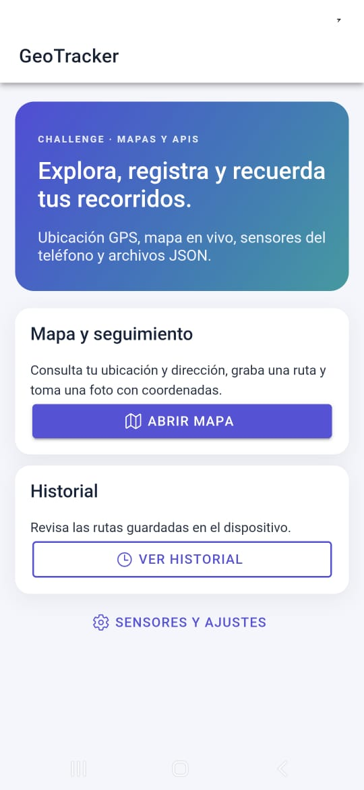
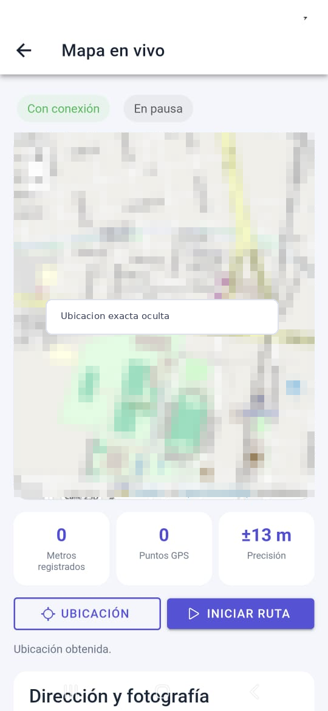
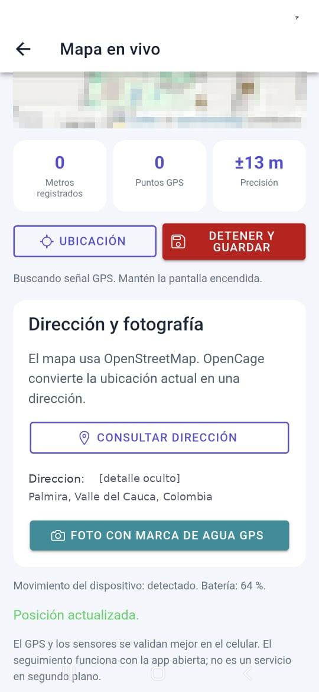
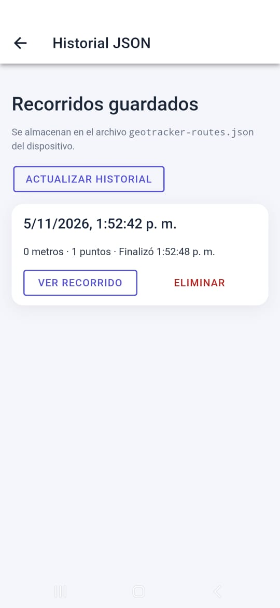
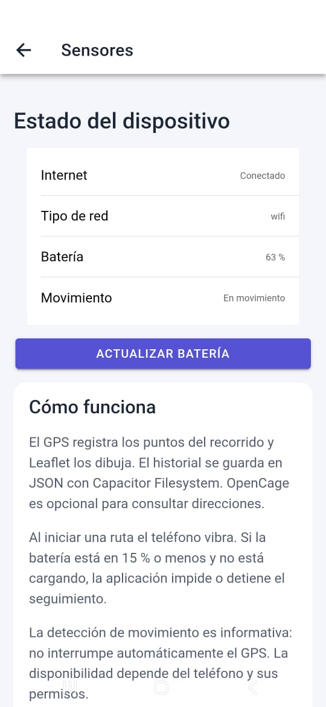

# GeoTracker — Mapas, APIs y sensores

**Autora:** Natalia Paredes  
**Asignatura:** Desarrollo de Software para Plataformas Móviles  
**Actividad:** Challenge de la Clase 10 — APIs y Maps (identificado como «Challenge 08» en las diapositivas)  
**Plataforma:** Ionic React + TypeScript + Capacitor (Android)

## Descripción

GeoTracker es una aplicación móvil para consultar la ubicación mediante GPS, visualizarla en un mapa interactivo, iniciar y detener el seguimiento de un recorrido y conservar registros en el almacenamiento local del dispositivo. También integra la API OpenCage para convertir coordenadas en una dirección aproximada y presenta información de conectividad, batería y movimiento del teléfono.

El objetivo es integrar **mapas, una API externa y distintos sensores nativos** en una sola aplicación, conforme al reto de la Clase 10.

## Evidencias fotográficas de funcionamiento

Las siguientes capturas fueron tomadas durante las pruebas de la aplicación en un teléfono Android. Por privacidad se ha ocultado la dirección exacta y parte del mapa; se mantiene visible la información funcional relevante. El recorrido de historial corresponde a una prueba en interiores, **1 punto GPS y 0 metros**, no a una ruta caminada.

### Pantalla principal



### Ubicación GPS y mapa en vivo



### Seguimiento y dirección consultada con OpenCage



### Historial de recorridos guardados en JSON



### Sensores y estado del dispositivo



## Tecnologías

| Tecnología | Uso |
| --- | --- |
| Ionic React + TypeScript | Interfaz y navegación entre pantallas |
| Capacitor 8 | Acceso a funcionalidades nativas de Android |
| Leaflet + React Leaflet | Visualización del mapa y trazado de coordenadas |
| OpenStreetMap | Mosaicos cartográficos |
| OpenCage Geocoding API | Geocodificación inversa: coordenadas a dirección aproximada |
| Capacitor Geolocation | Ubicación actual y seguimiento GPS |
| Capacitor Filesystem | Historial de rutas en un archivo JSON local |
| Capacitor Network | Estado de la conexión y tipo de red |
| Capacitor Motion | Indicación de movimiento del dispositivo |
| Capacitor Device | Consulta del nivel de batería y carga |
| Capacitor Haptics | Vibración al iniciar una ruta |
| Capacitor Camera | Captura de una fotografía |
| Capacitor Local Notifications | Plugin incluido para notificaciones |

## Funcionalidades

### Inicio y navegación

La pantalla principal permite acceder al **Mapa y seguimiento**, al **Historial** y a **Sensores y ajustes** mediante componentes de Ionic.

### Mapa y geolocalización

La sección **Mapa en vivo** representa la posición obtenida mediante GPS con un marcador sobre OpenStreetMap. Permite hacer zoom, solicitar una actualización de ubicación y consultar la precisión estimada de la medición.

### Seguimiento de recorridos

Los controles **Iniciar ruta** y **Detener y guardar** permiten comenzar y finalizar una sesión de seguimiento en primer plano. Los puntos GPS recibidos se utilizan para construir un trazado y calcular su distancia mediante coordenadas. Al iniciar, el dispositivo puede vibrar mediante Capacitor Haptics.

Para proteger el dispositivo, la aplicación contempla la batería baja: si el nivel es del **15 % o menos** y no se está cargando, impide o detiene el seguimiento. El indicador de movimiento es informativo, no controla automáticamente el rastreo.

La evidencia muestra la interfaz de seguimiento y la consulta de dirección. **La prueba documentada se hizo en interiores**, sin un recorrido largo: el registro guardado muestra un punto GPS y 0 metros. No se presenta como un desplazamiento físico de larga distancia.

### Consulta de direcciones y fotografía

Mediante el botón **Consultar dirección**, la aplicación envía las coordenadas a OpenCage y muestra una dirección aproximada. La sección también incorpora **Foto con marca de agua GPS**, diseñada para capturar una fotografía con las coordenadas y fecha incorporadas en la imagen y guardarla localmente.

La captura incluida documenta la consulta de dirección y la interfaz del botón fotográfico; no constituye por sí misma evidencia de una fotografía terminada y guardada.

### Historial en formato JSON

Los recorridos se almacenan mediante Capacitor Filesystem en `geotracker-routes.json`, dentro del almacenamiento privado de la aplicación. Desde **Historial JSON** es posible actualizar la lista, abrir el mapa de un registro mediante **Ver recorrido** y eliminar los registros.

La captura evidencia **un recorrido corto de prueba**, con **1 punto GPS y 0 metros**, guardado sin necesidad de salir a la calle.

### Sensores y ajustes

Se visualiza si existe conexión a Internet, el tipo de conexión, el porcentaje de batería y el estado de movimiento del dispositivo. También se ofrece una opción para actualizar el nivel de batería.

## Requisitos previos

- Node.js y npm compatibles con las dependencias declaradas en `package.json`.
- Ionic CLI instalado o disponible mediante `npx`.
- Android Studio y Android SDK para probar las funciones nativas en Android.
- Un teléfono Android con depuración USB habilitada para las pruebas físicas.
- Conexión a Internet para descargar las teselas del mapa y consultar OpenCage.
- Una clave de OpenCage, solo si se desea habilitar la consulta de direcciones.

## Clonar e instalar

Desde PowerShell:

```powershell
git clone https://github.com/nataliap2005/natalia-paredes-react-challenges.git
cd natalia-paredes-react-challenges
git switch challenge-09
cd geotracker
npm install --legacy-peer-deps
```

> El proyecto está en la rama `challenge-09`. Si ya tienes el repositorio clonado, actualiza la rama correspondiente en lugar de volver a clonarlo.

### Configurar OpenCage

Crea `.env` en la raíz de `geotracker` tomando como referencia `.env.example`:

```dotenv
VITE_OPENCAGE_KEY=TU_CLAVE_DE_OPENCAGE
```

Obtén tu clave desde [OpenCage](https://opencagedata.com/). **No subas `.env` al repositorio.** Las variables prefijadas con `VITE_` se incorporan al código cliente y pueden ser inspeccionadas; no deben contener secretos con privilegios administrativos.

La consulta de direcciones requiere una clave y conexión, pero el mapa y los componentes de la aplicación pueden probarse de forma independiente.

### Ejecutar en el navegador

```powershell
ionic serve
```

La ejecución web es útil para revisar la interfaz, pero la compatibilidad de GPS, movimiento, batería, cámara y vibración debe verificarse en el dispositivo físico.

### Compilar y ejecutar en Android

```powershell
npm run build
npx cap sync android
npx cap open android
```

Si Android aún no está integrado en una copia nueva de la aplicación, instálalo y agrégalo una sola vez:

```powershell
npm install @capacitor/android@8 --legacy-peer-deps
npx cap add android
```

En Android Studio selecciona el dispositivo y pulsa **Run**. Comprueba que `android/app/src/main/AndroidManifest.xml` incluya los permisos de Internet y localización:

```xml
<uses-permission android:name="android.permission.INTERNET" />
<uses-permission android:name="android.permission.ACCESS_COARSE_LOCATION" />
<uses-permission android:name="android.permission.ACCESS_FINE_LOCATION" />
```

El dispositivo debe conceder el permiso de ubicación durante el uso. El seguimiento está diseñado para funcionar **con la aplicación abierta**, no en segundo plano.

## Estructura principal

```text
geotracker/
├── src/
│   ├── components/
│   │   ├── MapComponent.tsx
│   │   ├── MapComponent.css
│   │   └── TrackingControls.tsx
│   ├── hooks/
│   │   ├── useGeolocation.ts
│   │   ├── useNetwork.ts
│   │   ├── useMotion.ts
│   │   └── useBattery.ts
│   ├── pages/
│   │   ├── Home.tsx
│   │   ├── MapPage.tsx
│   │   ├── History.tsx
│   │   └── Settings.tsx
│   ├── services/
│   │   ├── opencage.ts
│   │   └── trackingStorage.ts
│   ├── theme/
│   ├── App.tsx
│   └── main.tsx
├── imagenes/
│   ├── 01-inicio.png
│   ├── 02-mapa-ubicacion.png
│   ├── 03-direccion-seguimiento.png
│   ├── 04-historial-json.png
│   └── 05-sensores.png
├── .env.example
├── capacitor.config.ts
├── package.json
└── README.md
```

## Evidencias y alcance de las pruebas

Las cinco imágenes de este repositorio documentan una **ejecución en Android**: inicio, mapa con localización, consulta de dirección, registro breve en Historial JSON y lectura de sensores.

Las pruebas se realizaron **desde un lugar seguro y sin desplazamiento exterior**. Por tanto, las capturas no demuestran la reconstrucción de una ruta larga; sí muestran que se puede iniciar el seguimiento, registrar una posición y conservar un registro JSON. El funcionamiento de la cámara con marca de agua está implementado en el código, pero estas cinco evidencias no incluyen una fotografía capturada.

No se incluyó video en esta entrega.

## Consideraciones de privacidad

- Los recorridos y fotografías se guardan en el almacenamiento privado local del dispositivo, no automáticamente en la nube.
- OpenCage recibe las coordenadas cuando se consulta una dirección.
- Las capturas del mapa y la dirección pueden revelar información precisa de ubicación. **Antes de publicar el repositorio, revisa si deseas ocultar esa información de las imágenes.**
- La precisión del GPS puede variar, especialmente en interiores.

## Autora

**Natalia Paredes**  
Desarrollo de Software para Plataformas Móviles — Challenge de Mapas y APIs.
