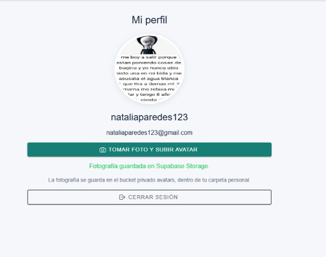
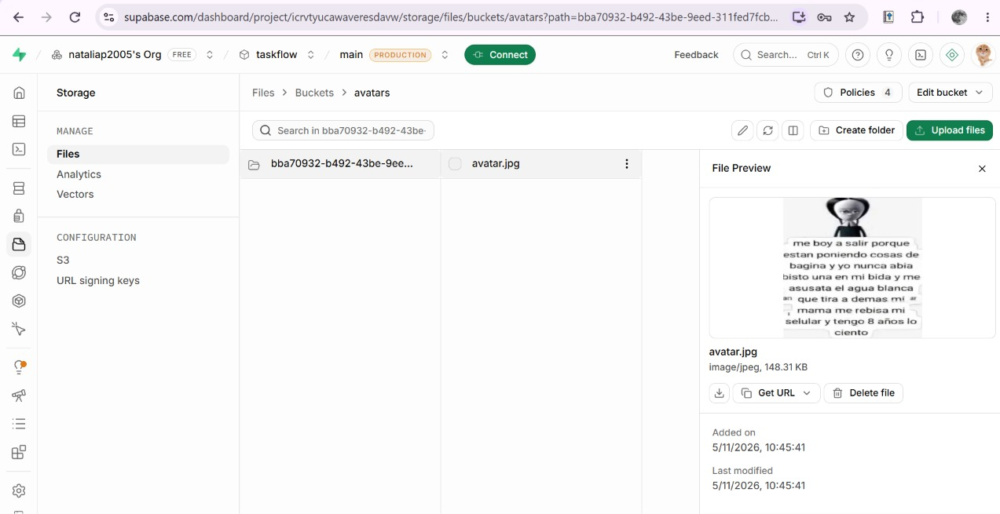
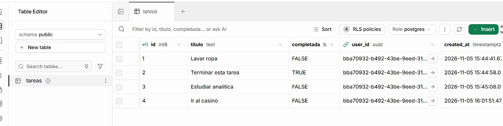
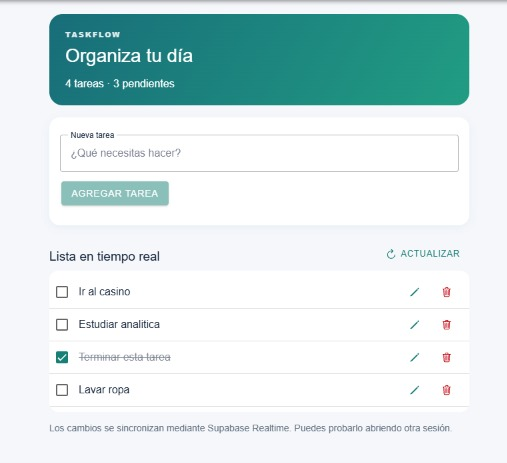
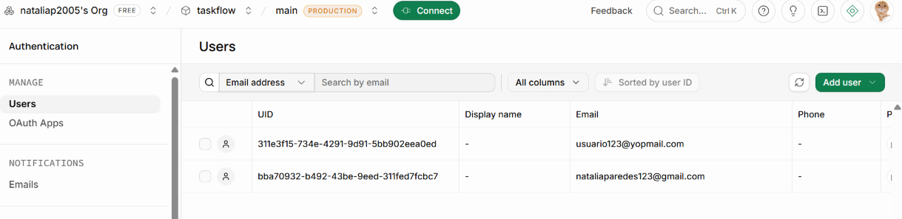

# TaskFlow — Challenge 08

**Autora:** Natalia Paredes  
**Asignatura:** Desarrollo de Software para Plataformas Móviles  
**Tecnologías:** Ionic React, TypeScript, Capacitor y Supabase  
**Repositorio:** [natalia-paredes-react-challenges](https://github.com/nataliap2005/natalia-paredes-react-challenges)  
**Rama de desarrollo:** `challenge-08`

## Descripción

**TaskFlow** es una aplicación de gestión de tareas desarrollada con **Ionic React** que utiliza **Supabase** como servicio de backend. Permite registrar usuarios, iniciar sesión y administrar tareas personales con operaciones CRUD. Los cambios en la base de datos pueden sincronizarse con la lista mediante **Supabase Realtime**. También incorpora un perfil de usuario que permite capturar o seleccionar una fotografía con **Capacitor Camera** y almacenarla en un bucket privado de **Supabase Storage**.

El proyecto corresponde al **Challenge 08** de la **Clase 09 — Supabase**, cuyo alcance incluye crear la tabla `tareas` con seguridad RLS, configurar el bucket `avatars`, implementar autenticación, CRUD, lista en tiempo real y uso de componentes Ionic con captura de fotografías.

## Funcionalidades

| Módulo | Funcionalidad | Tecnología |
| --- | --- | --- |
| Autenticación | Registro, inicio de sesión, sesión persistente y cierre de sesión | Supabase Auth |
| Tareas | Crear, consultar, editar, completar y eliminar tareas | Supabase PostgreSQL |
| Seguridad | Acceso restringido a las tareas del usuario autenticado | Row Level Security (RLS) |
| Tiempo real | Escuchar cambios en `tareas` y actualizar la lista | Supabase Realtime |
| Perfil | Mostrar el usuario, capturar o seleccionar una fotografía y actualizar el avatar | Ionic + Capacitor Camera |
| Archivos | Guardar fotografías por usuario en el bucket privado `avatars` | Supabase Storage |

### Modelo de datos

La tabla `public.tareas` almacena los siguientes campos:

| Columna | Tipo | Descripción |
| --- | --- | --- |
| `id` | `bigint` | Identificador único de la tarea |
| `titulo` | `text` | Descripción de la tarea |
| `completada` | `boolean` | Estado pendiente o completado |
| `user_id` | `uuid` | Identificador del usuario propietario |
| `created_at` | `timestamptz` | Fecha y hora de creación |

Las políticas RLS restringen el acceso desde la aplicación a las tareas del usuario autenticado. La fotografía de perfil se almacena en `avatars/<UID>/avatar.jpg` y se consulta mediante una URL firmada temporal, dado que el bucket es privado.

## Evidencias de funcionamiento

Las siguientes capturas corresponden a pruebas realizadas **desde el navegador** con el proyecto Supabase conectado. No son capturas de una ejecución nativa de Android.

### 1. Perfil y confirmación de carga de fotografía

La pantalla de perfil muestra los datos del usuario, una vista previa del avatar y el mensaje **«Fotografía guardada en Supabase Storage»** luego de la carga.



### 2. Fotografía almacenada en Supabase Storage

En el panel de Supabase se observa el bucket privado `avatars`, una carpeta identificada con el UID del usuario y el archivo `avatar.jpg` almacenado correctamente.



### 3. Registros almacenados en PostgreSQL

La tabla `public.tareas` muestra las tareas creadas, su identificador, título, estado `completada`, `user_id` y fecha de creación. En la evidencia también se observa una tarea marcada como completada.



### 4. Lista de tareas en la aplicación

La pantalla principal presenta las tareas del usuario, el conteo de pendientes y las acciones disponibles para agregar, editar, marcar como completada y eliminar. La interfaz incluye la lista conectada a Supabase Realtime.



### 5. Usuarios registrados en Supabase Auth

El panel **Authentication → Users** muestra las cuentas creadas en el proyecto. Cada usuario posee un UID que se utiliza para asociar sus tareas y su carpeta de imágenes.



## Requisitos

- **Node.js y npm** compatibles con el proyecto.
- **Ionic CLI**, instalable con `npm install -g @ionic/cli`.
- Cuenta y proyecto de **Supabase** con acceso a **SQL Editor** y **Project Settings**.
- Navegador moderno para las pruebas web; permitir acceso a la cámara cuando corresponda.
- **Opcional para ejecución nativa:** Android Studio, Android SDK, teléfono Android o emulador.

## Instalación y ejecución

### 1. Clonar el repositorio y seleccionar la rama

```powershell
git clone https://github.com/nataliap2005/natalia-paredes-react-challenges.git
cd natalia-paredes-react-challenges
git switch challenge-08
cd taskflow
```

### 2. Instalar las dependencias

```powershell
npm install --legacy-peer-deps
```

Se utiliza `--legacy-peer-deps` porque durante la creación del proyecto se presentó un problema de resolución de dependencias de npm.

### 3. Preparar Supabase

1. Crear un proyecto en [Supabase](https://supabase.com/dashboard).
2. Abrir **SQL Editor → New query**.
3. Ejecutar el script [`supabase/schema.sql`](./supabase/schema.sql) para crear `tareas`, sus políticas RLS, la publicación Realtime y el bucket `avatars` con políticas de acceso.
4. En caso de haber creado el proyecto con **Automatically expose new tables** desactivado, verificar que el script incluya los permisos SQL `GRANT` necesarios para `authenticated` sobre `public.tareas` y su secuencia.
5. En **Authentication**, mantener habilitado el proveedor de correo electrónico. Si se requiere confirmación por email, configurar **URL Configuration** con la dirección local de la aplicación.

**Seguridad:** no utilizar claves secretas ni `service_role` dentro de una aplicación cliente. No habilitar lectura pública de las tareas.

### 4. Configurar variables de entorno

Crear un archivo `.env` en `taskflow/`, tomando `.env.example` como referencia:

```dotenv
VITE_SUPABASE_URL=https://TU_PROJECT_REF.supabase.co
VITE_SUPABASE_KEY=sb_publishable_TU_CLAVE
```

Obtener la URL desde **Project Settings → Data API** y la clave pública desde **Project Settings → API Keys**. No se necesita incluir la contraseña de PostgreSQL en la aplicación.

Mantener `.env` fuera de Git con `.gitignore`. Los controles reales de acceso se establecen mediante Authentication, RLS y las políticas de Storage.

### 5. Ejecutar en el navegador

```powershell
ionic serve
```

La aplicación se inicia normalmente en `http://localhost:8100/`. Si se modifica `.env`, reiniciar el servidor de desarrollo.

### 6. Compilar

```powershell
npm run build
```

### 7. Ejecución en Android (opcional)

Para probar la captura con la cámara nativa del teléfono:

```powershell
npm install @capacitor/android@8 --legacy-peer-deps
npm run build
npx cap add android
npx cap sync android
npx cap open android
```

Si la carpeta `android/` ya existe, **omitir** `npx cap add android`. Abrir el proyecto desde Android Studio y ejecutarlo en un dispositivo o emulador. Luego de cambios al frontend, volver a ejecutar `npm run build` y `npx cap sync android`.

## Pruebas funcionales sugeridas

| Prueba | Resultado esperado |
| --- | --- |
| Registro e inicio de sesión | Se crea o recupera la cuenta y se muestra la pantalla principal. |
| Crear una tarea | Aparece en TaskFlow y se guarda en `public.tareas`. |
| Editar tarea | Se actualiza el título en la interfaz y en PostgreSQL. |
| Completar tarea | El campo `completada` cambia a `true`. |
| Eliminar tarea | El registro desaparece de la aplicación y de la tabla. |
| Seguridad RLS | Otra cuenta no puede consultar ni editar tareas ajenas desde la aplicación. |
| Realtime | Con la misma cuenta abierta en dos sesiones, los cambios realizados en una se reflejan en la otra. |
| Fotografía de perfil | Se muestra el avatar y existe `avatars/<UID>/avatar.jpg` en Storage. |

Las capturas anteriores permiten verificar la persistencia de tareas y fotografía, además de la existencia de usuarios. Las pruebas de sincronización simultánea y de cámara nativa requieren su propia comprobación si se desean documentar como realizadas.

## Estructura principal

```text
taskflow/
├── src/
│   ├── components/       # Componentes reutilizables
│   ├── contexts/         # Estado de autenticación
│   ├── hooks/            # Tareas, Realtime y cámara
│   ├── lib/              # Cliente de Supabase
│   ├── pages/            # Login, registro, Home, formulario y perfil
│   ├── services/         # CRUD de tareas y avatares
│   └── theme/            # Estilos de Ionic y de la aplicación
├── supabase/
│   └── schema.sql        # Tabla, políticas RLS, Realtime y Storage
├── imagenes/             # Capturas de evidencia para GitHub
├── .env.example
├── capacitor.config.ts
├── package.json
└── README.md
```

## Referencias

- [Documentación de Ionic Framework](https://ionicframework.com/docs)
- [Documentación de Capacitor](https://capacitorjs.com/docs)
- [Documentación de Supabase](https://supabase.com/docs)
- [Supabase Row Level Security](https://supabase.com/docs/guides/database/postgres/row-level-security)
- [Supabase Storage](https://supabase.com/docs/guides/storage)

---

**Natalia Paredes**  
**Desarrollo de Software para Plataformas Móviles — Challenge 08**
