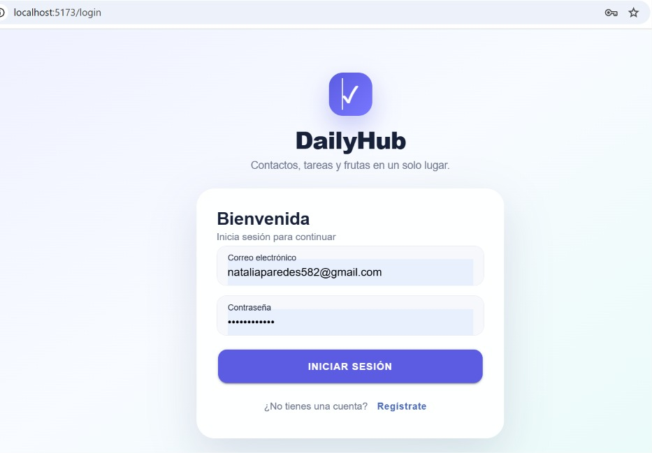
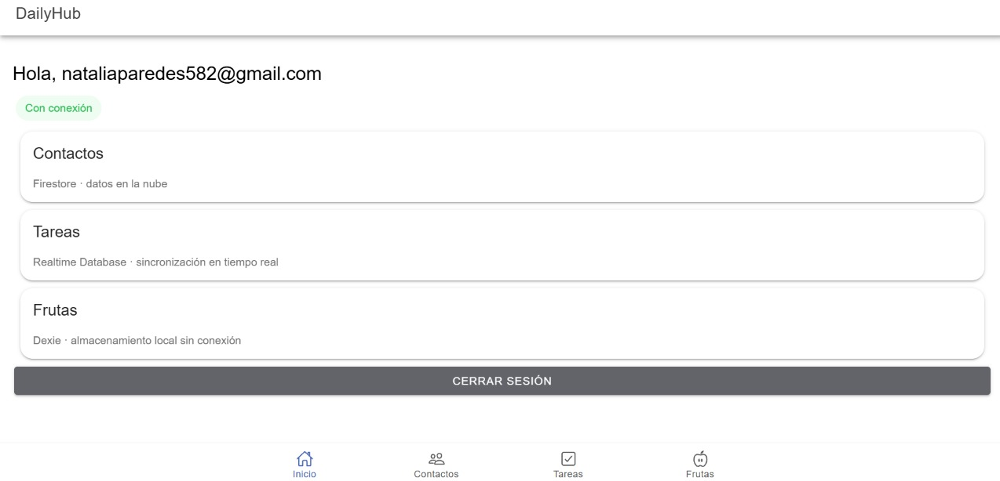
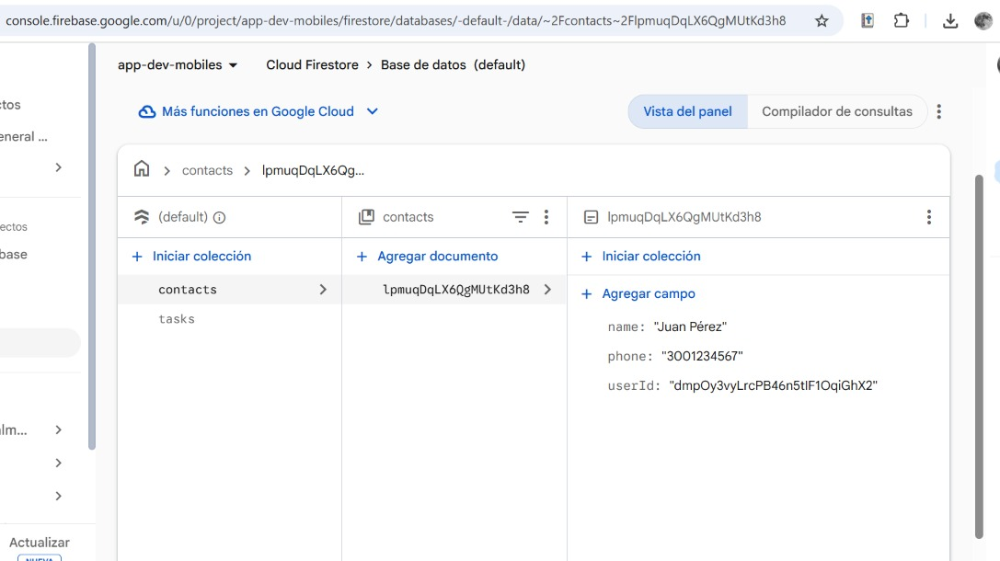
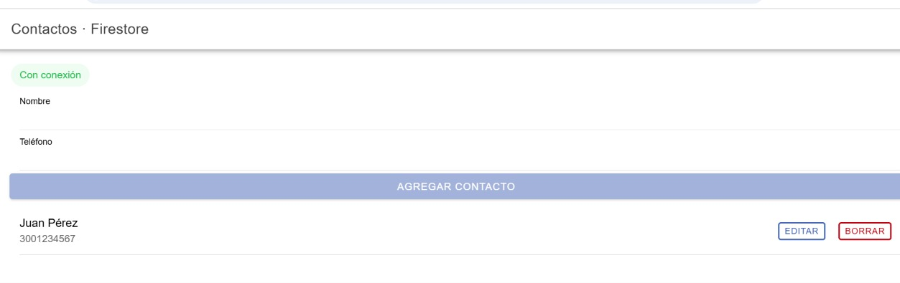
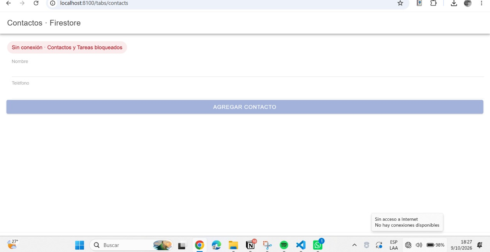
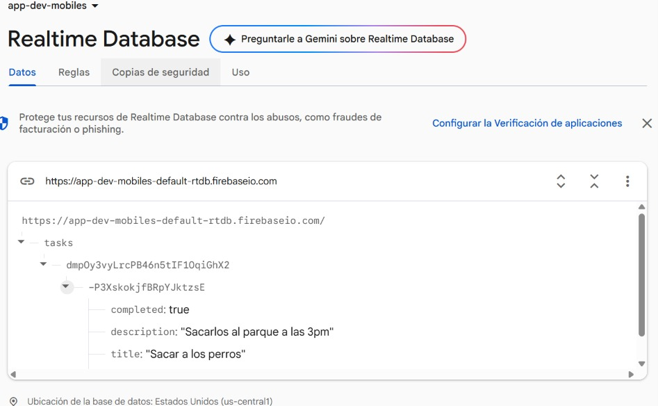
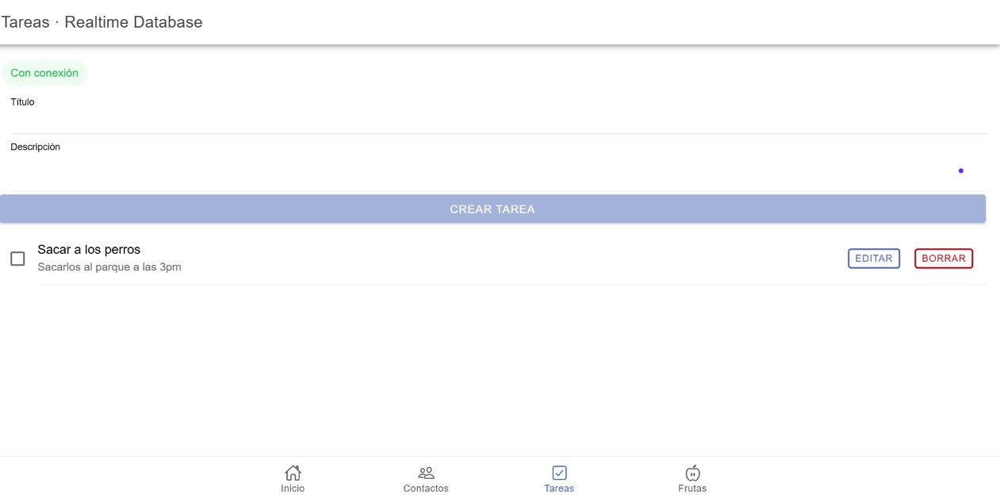
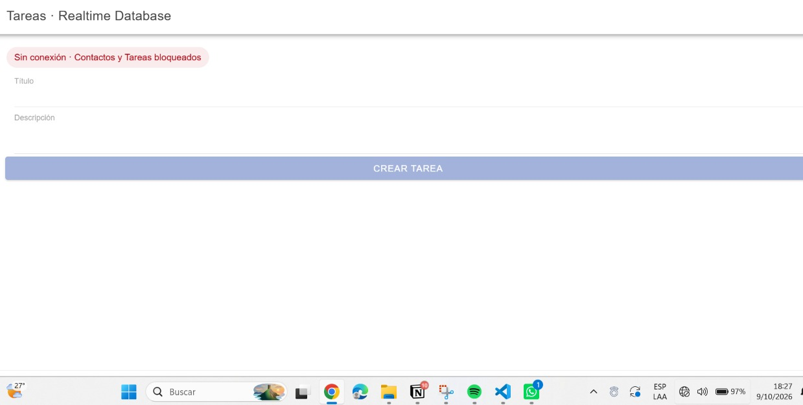
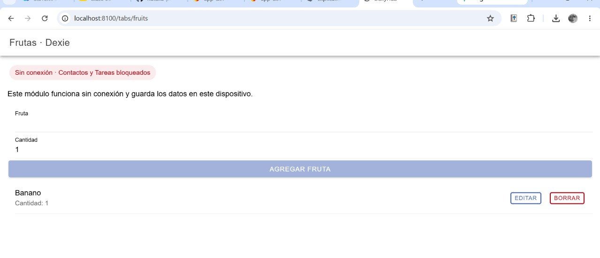
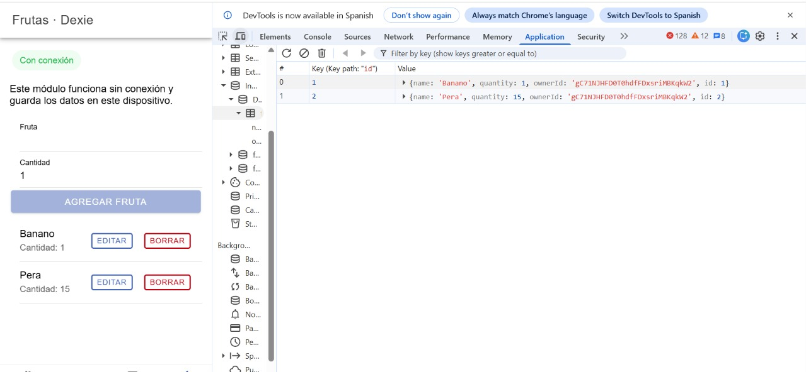

# DailyHub — Challenge 06

**Desarrollo de Software para Plataformas Móviles**  
**Challenge 06: Storage & Sensors**

DailyHub es una aplicación desarrollada en **Ionic React + TypeScript** que integra autenticación real, gestión de contactos, tareas y frutas, y detección del estado de conexión. Cada módulo utiliza el almacenamiento indicado en el Challenge 06.

## Funcionalidades

| Módulo | Tecnología | Funcionalidad |
|---|---|---|
| Autenticación | Firebase Authentication | Iniciar sesión, registrar usuarios y cerrar sesión |
| Contactos | Cloud Firestore | Listar, crear, editar y eliminar contactos asociados al usuario |
| Tareas | Firebase Realtime Database | Listar, crear, editar, completar y eliminar tareas |
| Frutas | Dexie / IndexedDB | Guardar, consultar, editar y eliminar frutas de forma local |
| Conectividad | Capacitor Network (`useNetwork`) | Mostrar el estado de conexión y bloquear acciones de Contactos y Tareas sin Internet |
| Navegación | Ionic React Router | Acceder a Inicio, Contactos, Tareas y Frutas |

## Tecnologías utilizadas

- **Ionic React y TypeScript:** interfaz de usuario y estructura de la aplicación.
- **React Router:** navegación entre pantallas.
- **Firebase Authentication:** autenticación de usuarios.
- **Cloud Firestore:** persistencia de contactos en la nube.
- **Firebase Realtime Database:** persistencia y actualizaciones de tareas en tiempo real.
- **Dexie e IndexedDB:** almacenamiento local para frutas.
- **Capacitor Network:** consulta y seguimiento del estado de red mediante un hook personalizado.
- **Vite:** entorno de desarrollo y compilación.

## Estructura del proyecto

```text
src/
├── pages/           # Login, registro, inicio y módulos
├── hooks/           # Firebase, Dexie y conectividad
├── contexts/        # Estado compartido de autenticación
├── firebase/         # Configuración de Firebase
└── db/               # Configuración local de Dexie
```

## Instalación y ejecución

Desde la carpeta `dailyhub`:

```bash
npm install
npm run dev
```

Alternativamente, se puede iniciar con:

```bash
ionic serve
```

Para comprobar la compilación:

```bash
npm run build
```

### Configuración de Firebase

Crear un archivo `.env` en la raíz de `dailyhub`, tomando como referencia `.env.example`:

```dotenv
VITE_FIREBASE_API_KEY=
VITE_FIREBASE_AUTH_DOMAIN=
VITE_FIREBASE_DATABASE_URL=
VITE_FIREBASE_PROJECT_ID=
VITE_FIREBASE_STORAGE_BUCKET=
VITE_FIREBASE_MESSAGING_SENDER_ID=
VITE_FIREBASE_APP_ID=
```

Los valores se obtienen en **Firebase Console → Configuración del proyecto** y desde la URL de **Realtime Database**. También se debe habilitar el acceso por correo y contraseña en **Authentication** y configurar reglas de seguridad por usuario para Firestore y Realtime Database. El archivo `.env` no debe subirse al repositorio.

## Evidencias del funcionamiento

Las siguientes capturas muestran la aplicación y los registros creados durante las pruebas del Challenge 06.

### 1. Autenticación e inicio

**Inicio de sesión:** pantalla de acceso mediante Firebase Authentication.



**Página de inicio:** usuario autenticado, estado de conexión y navegación a los tres módulos.



### 2. Contactos — Cloud Firestore

**Persistencia en la nube:** documento `contacts` visible en Firebase Console con nombre, teléfono y `userId`.



**Con conexión:** lista de contactos y controles de administración disponibles.



**Sin conexión:** indicador de estado rojo y acciones de Contactos deshabilitadas.



### 3. Tareas — Firebase Realtime Database

**Persistencia en tiempo real:** estructura `tasks / uid / idDeTarea` y campos de una tarea visibles en Firebase Console.



**Con conexión:** listado de tareas con controles para crear, completar, editar y eliminar.



**Sin conexión:** aviso de conexión y acciones de Tareas deshabilitadas.



### 4. Frutas — Dexie / IndexedDB

**Sin conexión:** el módulo de Frutas permanece disponible y conserva la lista de registros locales.



**Verificación en IndexedDB:** en Chrome DevTools, pestaña **Application → IndexedDB**, aparecen los registros de frutas (por ejemplo, Banano y Pera) con sus cantidades.



## Comportamiento de red

El hook personalizado `useNetwork` determina el estado de conectividad y la interfaz lo muestra al usuario. Se probó el comportamiento con la aplicación abierta al desconectar la conexión de Windows.

| Operación | Con Internet | Sin Internet |
|---|---|---|
| Consultar y modificar Contactos | Disponible | Acciones de modificación bloqueadas |
| Consultar y modificar Tareas | Disponible | Acciones de modificación bloqueadas |
| Trabajar con Frutas en Dexie | Disponible | Disponible localmente |

**Nota:** la detección de red permite controlar la interfaz, pero no garantiza disponibilidad permanente de Firebase. Las capturas documentan las pruebas realizadas en el navegador; el comportamiento sin Internet se verificó manteniendo la aplicación abierta.

## Cumplimiento del Challenge 06

- [x] Nueva aplicación en Ionic con autenticación real y rutas.
- [x] Contactos almacenados en Firebase (Cloud Firestore).
- [x] Tareas almacenadas en Firebase Realtime Database.
- [x] Frutas almacenadas localmente con Dexie.
- [x] Detección de conectividad con Capacitor Network.
- [x] Bloqueo de acciones de Contactos y Tareas sin conexión.
- [x] Disponibilidad del módulo de Frutas sin conexión.

## Evidencia y entrega

Las capturas están en [`evidencias/`](evidencias/). Para que GitHub las muestre, conservar esta carpeta **junto al archivo `README.md`** con la misma estructura de rutas relativas.
